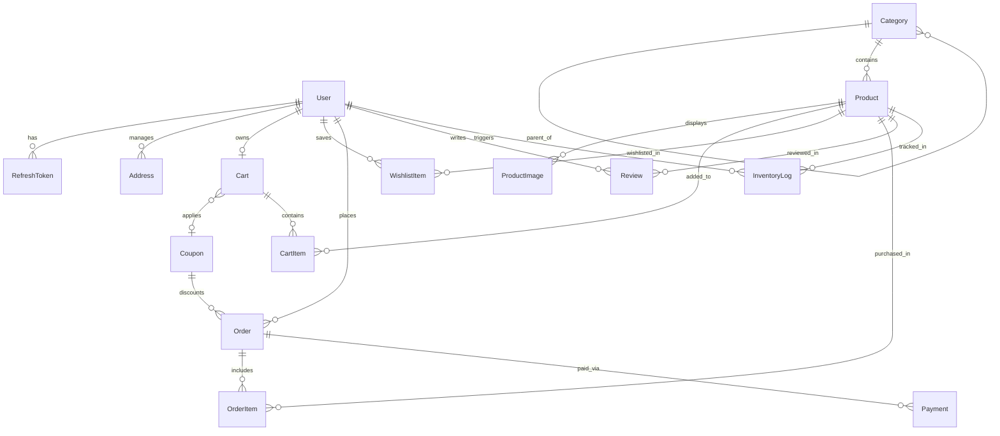

# ShopSphere — Production-Style E-Commerce Platform (India)

**ShopSphere** is a full-stack e-commerce web application engineered for the Indian market (`INR` stored strictly as integer paise, Indian 6-digit PIN codes & 36 State/UT addresses, 18% GST tax calculation, and a pluggable payment gateway supporting both an instant **Mock Payment Adapter** and **Razorpay Test Mode** with server-side HMAC-SHA256 signature & idempotent webhook verification).

---

## Tech Stack

| Layer | Technologies |
| :--- | :--- |
| **Frontend** | React 18, TypeScript, Vite, Tailwind CSS, React Router v6, TanStack Query v5, React Hook Form, Zod, Lucide Icons, Recharts |
| **Backend** | Node.js 20, Express, TypeScript, Zod (`routes → controllers → services → prisma`) |
| **Database** | PostgreSQL 16 (Docker Compose), Prisma ORM (`^6.5.0`), SQL Migrations, Idempotent Seed Scripts |
| **Security & Auth** | `HttpOnly` Cookies, Bcrypt Password Hashing, RBAC (`CUSTOMER`, `ADMIN`), HMAC Double-Submit CSRF Protection, Rate Limiting, Helmet |
| **Payments** | Pluggable Payment Adapter: Mock Payment Adapter + Razorpay Test Mode (Server-side HMAC Signature & Webhook Verification) |
| **DevOps & QA** | Docker, Docker Compose, **71 Automated Tests** (51 Backend Vitest + Supertest, 20 Frontend Vitest + React Testing Library), GitHub Actions CI, OpenAPI 3.0.3 / Swagger UI |

---

## Architecture, Documentation & Deliverables

- **System Architecture & Folder Structure:** [`docs/ARCHITECTURE.md`](./docs/ARCHITECTURE.md)
- **Production Deployment & Operations Guide:** [`docs/DEPLOYMENT.md`](./docs/DEPLOYMENT.md)
- **Interactive Swagger UI (when backend is running):** `http://localhost:4000/api/v1/docs`
- **OpenAPI 3.0.3 JSON Specification:** [`backend/src/docs/openapi.ts`](./backend/src/docs/openapi.ts) (`GET /api/v1/docs.json`)
- **Prisma Database Schema:** [`backend/prisma/schema.prisma`](./backend/prisma/schema.prisma)
- **Initial SQL Migration:** [`backend/prisma/migrations/20261020041123_init/migration.sql`](./backend/prisma/migrations/20261020041123_init/migration.sql)
- **Database Seed Script (24 Demo Products):** [`backend/prisma/seed.ts`](./backend/prisma/seed.ts)
- **Docker Compose & Containerization:** [`docker-compose.yml`](./docker-compose.yml), [`backend/Dockerfile`](./backend/Dockerfile), [`frontend/Dockerfile`](./frontend/Dockerfile)
- **GitHub Actions CI Pipeline:** [`.github/workflows/ci.yml`](./.github/workflows/ci.yml)

---

## Quick Start (Local Development)

```bash
# 1. Start PostgreSQL 16 container in the background
docker compose up -d postgres

# 2. Install backend dependencies, run migrations & seed demo catalog (24 products)
cd backend
cp .env.example .env
npm install
npm run prisma:migrate
npm run prisma:seed

# 3. Start backend development server (http://localhost:4000)
#    Swagger UI is available at http://localhost:4000/api/v1/docs
npm run dev

# 4. In a second terminal, install frontend dependencies & start Vite dev server (http://localhost:5173)
cd frontend
cp .env.example .env
npm install
npm run dev
```

### Full-Stack Containerized Run (Docker Compose)

```bash
# Build and start PostgreSQL 16 + Backend API (port 4000) + Frontend Nginx (port 8080)
docker compose up -d --build
```

### Verification Commands (Typecheck, Automated Tests & Build)

```bash
# Backend checks (51 integration & security tests across 5 test files)
cd backend && npm run typecheck && npm test && npm run build

# Frontend checks (20 component & flow tests across 3 test files)
cd frontend && npm run typecheck && npm test && npm run build

# Validate Docker Compose configuration
docker compose config -q
```

### Development-Only Demo Accounts
> **Security Rule #12:** Demo accounts are only seeded when `NODE_ENV !== 'production'` and are configured via `backend/.env`.
- **Demo Admin:** `admin@shopsphere.in` / `AdminPassword123!`
- **Demo Customer:** `aarav.sharma@example.in` / `CustomerPassword123!`

---

## Database Entity-Relationship (ER) Diagram



---

## Mandatory Security Decisions & Engineering Trade-Offs

### 1. Security Decisions Implemented
1. **Integer Paise Accounting (`Int` in PostgreSQL):** All prices, MRPs, discounts, shipping fees, and 18% GST taxes are stored and calculated exclusively as integer paise (`₹1.00 = 100 paise`), eliminating IEEE-754 floating-point rounding bugs (`0.1 + 0.2 !== 0.3`).
2. **Zero Client Trust on Prices, Totals & Roles:** Cart and checkout endpoints accept only `productId`, `quantity`, `addressId`, and `couponCode`. Injected client fields like `pricePaise`, `totalPaise`, `paymentStatus`, or `role: "ADMIN"` are stripped/ignored, and totals are recomputed strictly from PostgreSQL.
3. **Atomic Stock Deduction (`updateMany` Guard):** Inside `prisma.$transaction`, each ordered item executes:
   ```ts
   await tx.product.updateMany({
     where: { id: product.id, isActive: true, stockQuantity: { gte: item.quantity } },
     data: { stockQuantity: { decrement: item.quantity } },
   });
   ```
   If concurrent buyers race for the last unit in stock, PostgreSQL row-level locking ensures `updated.count === 0` for the second buyer, rolling back the transaction with `400 INSUFFICIENT_STOCK` and preventing negative inventory.
4. **Cookie Authentication + HMAC Double-Submit CSRF:** JWT access (`15m`) and refresh (`7d`) tokens are stored in `HttpOnly; SameSite=Lax` cookies (protecting tokens from XSS reading), while mutating requests (`POST`, `PUT`, `PATCH`, `DELETE`) require an `X-CSRF-Token` header matching the HMAC-signed `shopsphere_csrf` cookie verified with `crypto.timingSafeEqual`.
5. **Cryptographic Payment Verification & Webhook Idempotency:** Razorpay callbacks and webhooks verify `HMAC-SHA256` signatures using `crypto.timingSafeEqual`, and webhook events record a unique `webhookEventId` to guarantee idempotency across retries.
6. **Strict Ownership Isolation (IDOR Protection):** Every cart, order, address, and review mutation scopes queries to `req.user.id` (unless explicitly handled by an authorized `ADMIN` route).

### 2. Engineering Trade-Offs
- **Stock Reservation at Order Creation vs. Payment Capture:** Stock is atomically decremented when an order is created (`ORDER_RESERVED`) rather than waiting for asynchronous payment capture. *Trade-off:* Prevents two customers from paying for the same last unit simultaneously; if a customer cancels or payment fails and the order is cancelled, stock is atomically restored (`ORDER_CANCELLED`).
- **Denormalized `averageRating` & `reviewCount` on `Product`:** Stored directly on the `products` table and recalculated inside a transaction whenever a review is submitted, deleted, or moderated by an admin. *Trade-off:* Slightly more work on review writes in exchange for fast `O(1)` rating reads and `ORDER BY average_rating DESC` sorting on catalog pages without expensive `AVG()` joins on every catalog request.
- **Immutable JSONB Shipping & Order Item Snapshots:** `Order.shippingAddressSnapshot` and `OrderItem.unitPricePaise` snapshot the customer's address and product price at checkout time. *Trade-off:* Uses a few extra bytes per order row, but ensures historical GST invoices remain legally accurate even if the customer later edits their address or an admin changes a product's price.

---

## Implemented Frontend Routes (All 14 Required Views)

| Route | Component | Description |
| :--- | :--- | :--- |
| `/` | `HomePage` | Hero banner, active seeded promo code display (`WELCOME10`, `FESTIVE500`, `CAMPUS15`), live Shop-by-Category grid, Featured Deals grid, and New Arrivals |
| `/products` | `ProductListingPage` | URL-synchronized search (`q`), category filter, Rupee-to-paise price range filter, in-stock & featured toggles, sorting (`newest`, `price_asc`, `price_desc`, `rating_desc`, `name_asc`), active filter chips, and pagination |
| `/products/:slugOrId` | `ProductDetailsPage` | Breadcrumbs, multi-image gallery, `[DEMO]` & discount badges, integer paise to `₹` formatting, live stock indicator, Add-to-Cart & Wishlist toggles, JSONB technical specifications table, verified customer review submission & listing, and related products |
| `/cart` | `CartPage` | Persistent database-backed shopping cart, quantity controls with stock cap, 1-click promo coupon application (`WELCOME10`, `FESTIVE500`, `CAMPUS15`), free-shipping progress bar, and 18% GST tax summary |
| `/wishlist` | `WishlistPage` | Customer saved wishlist items with 1-click **Move to Cart** and item removal |
| `/checkout` | `CheckoutPage` | Indian delivery address selection + inline address creation, payment adapter selector (**Mock Instant Pay** vs **Razorpay Test Mode**), and transactional order placement |
| `/orders` | `OrdersPage` | Customer order history with status filter pills (`CONFIRMED`, `PENDING`, `SHIPPED`, `DELIVERED`, `CANCELLED`) |
| `/orders/:id` | `OrderDetailsPage` | Immutable order price & shipping snapshot, 18% GST tax invoice breakdown, payment transaction details, retry payment action, and atomic order cancellation with stock restoration |
| `/addresses` | `AddressesPage` | Full CRUD for Indian shipping addresses (6-digit PIN code, 10-digit mobile number, Indian State/UT selector, and default address toggle) |
| `/profile` | `ProfilePage` | Customer account management (name & Indian mobile number update) + quick navigation cards |
| `/admin` | `AdminDashboardPage` | RBAC-protected Admin Command Center with Recharts real-data analytics (`AreaChart` 14-day revenue trend + `BarChart` category sales), Product & Category management, Transactional Inventory Controls & `InventoryLog` audit trail, Order lifecycle status workflow, Coupon CRUD, and Review moderation |
| `/login` | `LoginPage` | React Hook Form + Zod validation + 1-click dev demo credential fill + `HttpOnly` cookie session login |
| `/register` | `RegisterPage` | Customer registration with Indian 10-digit mobile number validation and strong password rules |
| `*` | `NotFoundPage` | Accessible `404` page with quick links back to Home and Product Catalog |

---

## Implemented Backend APIs

| Method | Endpoint | Access | Description |
| :--- | :--- | :--- | :--- |
| `GET` | `/api/v1/health` | Public | Server health & live PostgreSQL connectivity check |
| `GET` | `/api/v1/docs` | Public | Interactive Swagger UI API documentation |
| `GET` | `/api/v1/docs.json` | Public | OpenAPI 3.0.3 machine-readable JSON specification |
| `GET` | `/api/v1/auth/csrf` | Public | Issues HMAC-signed CSRF token cookie & header value |
| `POST` | `/api/v1/auth/register` | Public (Rate-limited) | Customer registration (`Role.CUSTOMER` enforced) + persistent Cart |
| `POST` | `/api/v1/auth/login` | Public (Rate-limited) | Authenticates user and sets `HttpOnly` access/refresh cookies |
| `POST` | `/api/v1/auth/refresh` | Cookie Auth | Rotates access token using `HttpOnly` refresh token cookie |
| `POST` | `/api/v1/auth/logout` | Auth + CSRF | Clears authentication and CSRF cookies |
| `GET` | `/api/v1/auth/me` | Auth | Returns current authenticated user profile |
| `PATCH` | `/api/v1/auth/profile` | Auth + CSRF | Updates user name, Indian phone number, or password |
| `GET` | `/api/v1/categories` | Public | Lists active categories with product counts & hierarchy |
| `GET` | `/api/v1/categories/:slugOrId` | Public | Category details by slug or UUID |
| `POST` | `/api/v1/categories` | Admin + CSRF | Creates a new product category |
| `PATCH` | `/api/v1/categories/:id` | Admin + CSRF | Updates a category |
| `DELETE` | `/api/v1/categories/:id` | Admin + CSRF | Deletes empty category or soft-deactivates if products exist |
| `GET` | `/api/v1/products` | Public | Search (`q`), filter (`category`, `brand`, `minPricePaise`, `maxPricePaise`, `inStock`, `featured`), sort (`newest`, `price_asc`, `price_desc`, `rating_desc`, `name_asc`), and paginate (`page`, `limit`) |
| `GET` | `/api/v1/products/:slugOrId` | Public | Product details by slug or UUID, including images, specs, approved reviews, and related products |
| `POST` | `/api/v1/products` | Admin + CSRF | Creates product (`mrpPaise >= pricePaise`) and logs `INITIAL_STOCK` in `InventoryLog` |
| `PATCH` | `/api/v1/products/:id` | Admin + CSRF | Updates product details, integer paise prices, and images |
| `PATCH` | `/api/v1/products/:id/inventory` | Admin + CSRF | Transactional stock adjustment with `InventoryLog` audit record |
| `DELETE` | `/api/v1/products/:id` | Admin + CSRF | Soft-deactivates product (`isActive = false`) |
| `GET` | `/api/v1/cart` | Auth | Returns persistent cart with server-recalculated paise totals, coupon discount, shipping, and 18% GST |
| `POST` | `/api/v1/cart/items` | Auth + CSRF | Adds or increments product in cart with live stock validation |
| `PATCH` | `/api/v1/cart/items/:productId` | Auth + CSRF | Updates item quantity or removes item when `quantity = 0` |
| `DELETE` | `/api/v1/cart/items/:productId` | Auth + CSRF | Removes product from cart |
| `DELETE` | `/api/v1/cart` | Auth + CSRF | Clears all items and applied coupon from cart |
| `POST` | `/api/v1/cart/coupon` | Auth + CSRF | Validates and attaches promo coupon code to cart |
| `DELETE` | `/api/v1/cart/coupon` | Auth + CSRF | Removes applied coupon from cart |
| `GET` | `/api/v1/coupons/active` | Public | Lists active, non-expired promotional coupons |
| `POST` | `/api/v1/coupons/validate` | Auth + CSRF | Previews coupon eligibility and exact discount in paise |
| `GET` | `/api/v1/wishlist` | Auth | Lists customer's saved wishlist products |
| `POST` | `/api/v1/wishlist` | Auth + CSRF | Adds product to customer wishlist |
| `DELETE` | `/api/v1/wishlist/:productId` | Auth + CSRF | Removes product from customer wishlist |
| `GET` | `/api/v1/addresses` | Auth | Lists customer's saved Indian shipping addresses |
| `POST` | `/api/v1/addresses` | Auth + CSRF | Creates shipping address (6-digit PIN & 10-digit phone validated) |
| `PATCH` | `/api/v1/addresses/:id` | Auth + CSRF | Updates customer shipping address (ownership enforced) |
| `PATCH` | `/api/v1/addresses/:id/default` | Auth + CSRF | Marks address as default for the customer |
| `DELETE` | `/api/v1/addresses/:id` | Auth + CSRF | Deletes customer address (promotes newest remaining if default) |
| `POST` | `/api/v1/orders` | Auth + CSRF | Transactional order creation: atomic stock deduction (`updateMany` guard), immutable price/address snapshot, `InventoryLog` (`ORDER_RESERVED`), coupon increment, and cart clear |
| `GET` | `/api/v1/orders` | Auth | Paginated list of customer's own orders |
| `GET` | `/api/v1/orders/:id` | Auth | Order details with ownership enforcement (`CUSTOMER` vs `ADMIN`) |
| `POST` | `/api/v1/orders/:id/cancel` | Auth + CSRF | Atomic order cancellation for `PENDING`/`CONFIRMED`/`PROCESSING` orders with stock restoration (`ORDER_CANCELLED`) |
| `POST` | `/api/v1/payments/mock/verify` | Auth + CSRF | Verifies Mock payment (`SUCCESS`/`FAILURE`) and transitions order to `CONFIRMED` + `PAID` |
| `POST` | `/api/v1/payments/razorpay/create-order` | Auth + CSRF | Initializes Razorpay test order (`amountPaise` in INR) |
| `POST` | `/api/v1/payments/razorpay/verify` | Auth + CSRF | Verifies Razorpay `HMAC-SHA256` signature (`orderId\|paymentId`) using `crypto.timingSafeEqual` |
| `POST` | `/api/v1/payments/razorpay/webhook` | Public (HMAC Signed) | Idempotent Razorpay webhook handler (`x-razorpay-signature` + unique `webhookEventId`) |
| `GET` | `/api/v1/reviews/product/:productId` | Public | Lists approved product reviews |
| `POST` | `/api/v1/reviews/product/:productId` | Auth + CSRF | Submits/updates customer review with automatic verified-purchase detection (`DELIVERED`/`CONFIRMED` order check) and rating recalculation |
| `DELETE` | `/api/v1/reviews/:id` | Auth + CSRF | Deletes customer's own review (or admin removal) and recalculates product rating |
| `GET` | `/api/v1/admin/analytics` | Admin | Real-data PostgreSQL analytics: KPIs, orders by status, revenue by category, 14-day revenue time-series, top-selling products, and low-stock alerts |
| `GET` | `/api/v1/admin/orders` | Admin | Paginated list of all customer orders with status, payment status, and search filters |
| `PATCH` | `/api/v1/admin/orders/:id/status` | Admin + CSRF | Transitions order status (`PENDING → CONFIRMED → PROCESSING → SHIPPED → DELIVERED`) or cancels order with atomic stock restoration |
| `GET` | `/api/v1/admin/inventory-logs` | Admin | Paginated `InventoryLog` audit trail with product and actor details |
| `GET` | `/api/v1/admin/coupons` | Admin | Lists all promotional coupons (active, inactive, and expired) with order redemption counts |
| `POST` | `/api/v1/admin/coupons` | Admin + CSRF | Creates a new promotional coupon (`PERCENTAGE` or `FIXED_PAISE`) |
| `PATCH` | `/api/v1/admin/coupons/:id` | Admin + CSRF | Updates coupon rules, limits, expiry, or active status |
| `DELETE` | `/api/v1/admin/coupons/:id` | Admin + CSRF | Deletes unused coupon or soft-deactivates if referenced by historical orders |
| `GET` | `/api/v1/admin/reviews` | Admin | Paginated customer reviews across all statuses (`PENDING`, `APPROVED`, `REJECTED`) |
| `PATCH` | `/api/v1/admin/reviews/:id/moderate` | Admin + CSRF | Moderates review status and atomically recalculates product `averageRating` & `reviewCount` from approved reviews |

---

## Milestone Checklist

### Phase 1 — Foundation (Completed ✅)
- [x] **Step 1: Architecture & Database Design**
  - [x] Inspect local environment and workspace tools
  - [x] Define layered architecture and complete monorepo folder structure ([`docs/ARCHITECTURE.md`](./docs/ARCHITECTURE.md))
  - [x] Create initial Prisma schema ([`backend/prisma/schema.prisma`](./backend/prisma/schema.prisma)) and validate with Prisma CLI
  - [x] Create Mermaid ER diagram consistent with the Prisma schema
  - [x] Document major technical & security design decisions
- [x] **Step 2: Environment, Docker Compose & Backend Skeleton**
  - [x] Configure [`.env.example`](./.env.example), [`backend/.env.example`](./backend/.env.example), [`frontend/.env.example`](./frontend/.env.example), and [`docker-compose.yml`](./docker-compose.yml) for PostgreSQL 16
  - [x] Start and verify `shopsphere-postgres` container health
  - [x] Implement `/backend` TypeScript skeleton (`routes → controllers → services → prisma`), Zod environment validation, centralized error handling, rate limiting, integer paise currency utilities, and `/api/v1/health` endpoint
  - [x] Verify Prisma client generation, TypeScript typecheck, production build, and automated Vitest + Supertest health tests

### Phase 2 — Backend Core (Completed ✅)
- [x] Run initial Prisma migration (`20261020041123_init`) against PostgreSQL 16
- [x] Create and run idempotent seed script ([`backend/prisma/seed.ts`](./backend/prisma/seed.ts)) with 6 categories, **24 clearly labelled demo products** in integer paise, 3 demo coupons, and dev-only demo accounts
- [x] Implement authentication (`HttpOnly` cookies, bcrypt password hashing, HMAC Double-Submit CSRF protection, rate limiting) and server-side RBAC authorization (`CUSTOMER` vs `ADMIN`)
- [x] Implement Product & Category APIs (keyword search, category/brand/price-range/stock filtering, sorting, pagination, details, admin CRUD, and transactional inventory adjustments)
- [x] Enhance centralized error handling (Prisma constraint mapping) and verify with **23 passing integration tests**

### Phase 3 — Frontend Foundation (Completed ✅)
- [x] Initialize `/frontend` (React 18, TypeScript, Vite, Tailwind CSS, React Router v6, TanStack Query v5, React Hook Form, Zod, Lucide Icons, Recharts, Vitest)
- [x] Build design system, responsive `Navbar` & `Footer`, `MainLayout`, `ProductCard`, `Pagination`, `HomePage`, `ProductListingPage`, `ProductDetailsPage`, `LoginPage`, `RegisterPage`, and `NotFoundPage` (`404`)
- [x] Integrate frontend catalog and authentication views with real backend APIs and verify with **9 passing frontend tests**, `tsc --noEmit`, and `vite build`

### Phase 4 — Shopping Flow (Completed ✅)
- [x] Implement persistent Shopping Cart and Wishlist (backend + frontend)
- [x] Implement Customer Addresses, Coupons, and Checkout flow
- [x] Implement transactional Order creation, atomic stock validation (`updateMany`), cancellation rules with stock restoration, and Mock Payment Adapter
- [x] Implement Product Reviews (with automatic verified-purchase detection) and Razorpay Test Mode integration (HMAC-SHA256 signature + idempotent webhook verification)
- [x] Verify with **37 passing backend integration tests** and **15 passing frontend tests**

### Phase 5 — Administration (Completed ✅)
- [x] Implement Admin management APIs and UI (Products, Categories, Inventory logs, Orders, Coupons, Review moderation)
- [x] Implement real database-derived Admin Analytics dashboard with Recharts (`AreaChart` 14-day revenue trend and `BarChart` category sales)
- [x] Verify with **44 passing backend integration tests** and **20 passing frontend tests**

### Phase 6 — Completion & Hardening (Completed ✅)
- [x] Security audit, concurrency & IDOR test suite ([`backend/tests/phase6.security.test.ts`](./backend/tests/phase6.security.test.ts)), and Swagger/OpenAPI 3.0.3 documentation (`/api/v1/docs` & `/api/v1/docs.json`)
- [x] GitHub Actions CI workflow ([`.github/workflows/ci.yml`](./.github/workflows/ci.yml)) and full Docker containerization ([`backend/Dockerfile`](./backend/Dockerfile), [`frontend/Dockerfile`](./frontend/Dockerfile), [`docker-compose.yml`](./docker-compose.yml))
- [x] Final production-ready [`README.md`](./README.md) and [`docs/DEPLOYMENT.md`](./docs/DEPLOYMENT.md) verified with **51 passing backend tests** and **20 passing frontend tests**
