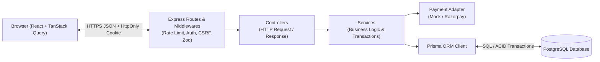

# ShopSphere — Architecture & Database Design Document

## 1. High-Level Architecture (Explained Simply)

Think of **ShopSphere** like a modern retail store with four distinct departments that communicate through strict rules:

1. **The Storefront (`frontend/` — React + TypeScript + Vite):**
   - Runs in the customer's browser.
   - Displays products, search filters, shopping cart, checkout form, and the admin dashboard.
   - **Golden Rule:** The browser is *untrusted*. Anyone can open Chrome DevTools and change a price on screen from ₹50,000 to ₹1. Therefore, the frontend only sends **intent** (e.g., *"Add 2 units of Product X to my cart"* or *"Checkout my cart with coupon `DIWALI20`"*), never final prices or permissions.
   - Uses **TanStack Query** to fetch and cache server data (like product lists and cart state) and **React Hook Form + Zod** to validate user forms before sending requests.

2. **The Security Gate & Reception (`backend/src/routes` & `middlewares` — Express):**
   - Every HTTP request from the browser hits Express middlewares first:
     - **Rate Limiter:** Stops brute-force password guessing and API abuse.
     - **Authentication & CSRF Middleware:** Reads the `HttpOnly` session/JWT cookie (which malicious JavaScript cannot steal via XSS) and verifies the CSRF token on state-changing requests (`POST`, `PATCH`, `DELETE`).
     - **Role Guard (`requireRole('ADMIN')`):** Blocks normal customers from calling admin routes.
     - **Zod Request Validator:** Rejects malformed JSON payloads before they reach our business logic.

3. **The Brain (`backend/src/controllers` & `services`):**
   - **Controllers** unpack the HTTP request (`req.params`, `req.query`, `req.body`, `req.user`), call a Service function, and send back a clean JSON HTTP response.
   - **Services** contain the real business rules:
     - Recalculating cart totals from live database prices (in **integer paise**).
     - Verifying coupon eligibility, expiry, minimum order value, and usage limits.
     - Executing **ACID database transactions** at checkout so checking stock, deducting inventory, creating the order snapshot, and logging the inventory change either **all succeed together or all roll back**.
     - Talking to payment providers via a clean **Payment Adapter** (`MockPaymentAdapter` first, then `RazorpayPaymentAdapter`).

4. **The Vault (`backend/prisma` + PostgreSQL):**
   - **PostgreSQL** is our relational database that enforces foreign keys, unique constraints, and ACID transactions.
   - **Prisma ORM** gives us type-safe TypeScript queries and version-controlled SQL migrations (`prisma/migrations`).



---

## 2. Proposed Repository Folder Structure

ShopSphere uses a clean monorepo-style layout containing `/backend`, `/frontend`, `/docs`, and infrastructure configuration at the root:

```text
ShopSphere/
├── .github/
│   └── workflows/
│       └── ci.yml                      # GitHub Actions CI (lint, typecheck, test, build)
├── backend/
│   ├── prisma/
│   │   ├── migrations/                 # Version-controlled SQL migrations
│   │   ├── schema.prisma               # Single source of truth for PostgreSQL schema
│   │   └── seed.ts                     # Idempotent seed script (20+ Indian market demo products, categories, coupons, demo accounts)
│   ├── src/
│   │   ├── config/
│   │   │   ├── env.ts                  # Zod-validated environment variables
│   │   │   ├── prisma.ts               # Singleton PrismaClient instance
│   │   │   └── swagger.ts              # OpenAPI / Swagger specification setup
│   │   ├── middlewares/
│   │   │   ├── auth.middleware.ts      # Cookie JWT verification & req.user attachment
│   │   │   ├── role.middleware.ts      # Server-side RBAC (CUSTOMER vs ADMIN)
│   │   │   ├── csrf.middleware.ts      # Double-submit / synchronizer CSRF protection
│   │   │   ├── rateLimit.middleware.ts # Route-specific rate limiters
│   │   │   ├── validate.middleware.ts  # Zod schema request validation middleware
│   │   │   └── error.middleware.ts     # Centralized safe error handler
│   │   ├── modules/                    # Feature modules (Routes -> Controllers -> Services -> Schemas)
│   │   │   ├── health/                 # Health & readiness endpoints
│   │   │   ├── auth/                   # Register, login, logout, me, CSRF token, password reset
│   │   │   ├── categories/             # Public listing & admin CRUD
│   │   │   ├── products/               # Search, filter, sort, pagination, details & admin CRUD
│   │   │   ├── inventory/              # Stock adjustments & InventoryLog audit history
│   │   │   ├── cart/                   # Persistent cart & server-side price calculation
│   │   │   ├── wishlist/               # Customer wishlist toggle & listing
│   │   │   ├── addresses/              # Customer Indian shipping addresses with ownership checks
│   │   │   ├── coupons/                # Coupon validation & admin management
│   │   │   ├── orders/                 # Transactional checkout, order lifecycle & cancellation rules
│   │   │   ├── payments/               # Payment adapter (Mock & Razorpay signature/webhook verification)
│   │   │   ├── reviews/                # Verified-purchase reviews & admin moderation
│   │   │   └── admin/                  # Real database-derived analytics & dashboard metrics
│   │   ├── utils/
│   │   │   ├── AppError.ts             # Custom operational error class
│   │   │   ├── asyncHandler.ts         # Async route wrapper
│   │   │   ├── currency.ts             # Paise calculation helpers
│   │   │   └── password.ts             # Argon2 / bcrypt password hashing utilities
│   │   ├── app.ts                      # Express app configuration (CORS, Helmet, cookies, routes)
│   │   └── server.ts                   # HTTP server entry point & graceful shutdown
│   ├── tests/                          # Automated unit & integration tests (Vitest + Supertest)
│   ├── .env.example                    # Placeholder environment variables
│   ├── Dockerfile                      # Production-ready backend container definition
│   ├── package.json
│   └── tsconfig.json
├── frontend/
│   ├── public/
│   ├── src/
│   │   ├── api/                        # Axios/Fetch client (with credentials & CSRF header) + endpoint modules
│   │   ├── components/
│   │   │   ├── common/                 # Buttons, inputs, badges, modals, pagination, skeletons
│   │   │   ├── layout/                 # Navbar, Footer, AdminSidebar, ProtectedRoute
│   │   │   ├── product/                # ProductCard, FilterSidebar, SortDropdown, ReviewList
│   │   │   └── cart/                   # CartDrawer / CartSummary, CouponBox
│   │   ├── context/                    # AuthContext / Theme or UI state
│   │   ├── hooks/                      # TanStack Query custom hooks (useProducts, useCart, useOrders, etc.)
│   │   ├── pages/
│   │   │   ├── HomePage.tsx
│   │   │   ├── ProductListingPage.tsx
│   │   │   ├── ProductDetailsPage.tsx
│   │   │   ├── CartPage.tsx
│   │   │   ├── CheckoutPage.tsx
│   │   │   ├── LoginPage.tsx
│   │   │   ├── RegisterPage.tsx
│   │   │   ├── ProfilePage.tsx
│   │   │   ├── AddressesPage.tsx
│   │   │   ├── OrdersPage.tsx
│   │   │   ├── OrderDetailsPage.tsx
│   │   │   ├── WishlistPage.tsx
│   │   │   ├── NotFoundPage.tsx
│   │   │   └── admin/
│   │   │       └── AdminDashboardPage.tsx  # Products, Categories, Inventory, Orders, Coupons, Reviews & Recharts Analytics
│   │   ├── types/                      # Shared TypeScript interfaces matching backend responses
│   │   ├── utils/
│   │   │   └── formatCurrency.ts       # Converts integer paise -> formatted ₹ INR string (en-IN)
│   │   ├── App.tsx
│   │   └── main.tsx
│   ├── .env.example
│   ├── Dockerfile
│   ├── index.html
│   ├── package.json
│   ├── tailwind.config.js
│   ├── tsconfig.json
│   └── vite.config.ts
├── docs/
│   └── ARCHITECTURE.md                 # Architecture, ER diagram, and technical design decisions
├── docker-compose.yml                  # PostgreSQL (+ optional pgAdmin / full stack services)
├── .gitignore
└── README.md                           # Project guide, setup instructions & living milestone checklist
```

---

## 3. Entity-Relationship (ER) Diagram

The Mermaid ER diagram below matches [`backend/prisma/schema.prisma`](../backend/prisma/schema.prisma) 1-to-1:

```mermaid
erDiagram
    USER ||--o{ ADDRESS : "saves"
    USER ||--o| CART : "owns"
    USER ||--o{ WISHLIST_ITEM : "saves"
    USER ||--o{ ORDER : "places"
    USER ||--o{ REVIEW : "writes"
    USER ||--o{ PASSWORD_RESET_TOKEN : "requests"
    USER ||--o{ INVENTORY_LOG : "performs (admin)"

    CATEGORY ||--o{ CATEGORY : "parent of"
    CATEGORY ||--o{ PRODUCT : "contains"

    PRODUCT ||--o{ PRODUCT_IMAGE : "has"
    PRODUCT ||--o{ CART_ITEM : "referenced in"
    PRODUCT ||--o{ WISHLIST_ITEM : "referenced in"
    PRODUCT ||--o{ ORDER_ITEM : "purchased as"
    PRODUCT ||--o{ REVIEW : "receives"
    PRODUCT ||--o{ INVENTORY_LOG : "tracked in"

    COUPON ||--o{ CART : "applied to"
    COUPON ||--o{ ORDER : "redeemed on"

    CART ||--o{ CART_ITEM : "contains"

    ORDER ||--o{ ORDER_ITEM : "contains"
    ORDER ||--o{ PAYMENT : "paid via"
    ORDER ||--o{ REVIEW : "verifies purchase"
    ORDER ||--o{ INVENTORY_LOG : "triggers"

    USER {
        uuid id PK
        varchar email UK
        varchar password_hash
        varchar full_name
        varchar phone
        enum role "CUSTOMER | ADMIN"
        boolean is_active
        timestamp created_at
        timestamp updated_at
    }

    PASSWORD_RESET_TOKEN {
        uuid id PK
        uuid user_id FK
        varchar token_hash UK
        timestamp expires_at
        timestamp used_at
        timestamp created_at
    }

    ADDRESS {
        uuid id PK
        uuid user_id FK
        varchar label
        varchar recipient_name
        varchar phone
        varchar line1
        varchar line2
        varchar landmark
        varchar city
        varchar state
        varchar postal_code "6-digit PIN"
        varchar country "IN"
        boolean is_default
        timestamp created_at
        timestamp updated_at
    }

    CATEGORY {
        uuid id PK
        varchar name UK
        varchar slug UK
        text description
        varchar image_url
        uuid parent_id FK
        boolean is_active
        timestamp created_at
        timestamp updated_at
    }

    PRODUCT {
        uuid id PK
        uuid category_id FK
        varchar sku UK
        varchar name
        varchar slug UK
        varchar short_description
        text description
        varchar brand
        int price_paise "Selling price in paise"
        int mrp_paise "MRP in paise"
        int stock_quantity
        int low_stock_threshold
        boolean is_active
        boolean is_featured
        jsonb specifications
        decimal average_rating
        int review_count
        timestamp created_at
        timestamp updated_at
    }

    PRODUCT_IMAGE {
        uuid id PK
        uuid product_id FK
        varchar url
        varchar alt_text
        int display_order
        boolean is_primary
        timestamp created_at
    }

    INVENTORY_LOG {
        uuid id PK
        uuid product_id FK
        uuid actor_user_id FK
        uuid order_id FK
        int change_quantity
        int previous_stock
        int new_stock
        enum reason "INITIAL_STOCK | ORDER_RESERVED | ORDER_CANCELLED | ADMIN_ADJUSTMENT | DAMAGED_OR_LOST"
        varchar notes
        timestamp created_at
    }

    COUPON {
        uuid id PK
        varchar code UK
        varchar description
        enum discount_type "PERCENTAGE | FIXED_PAISE"
        int discount_value
        int min_order_paise
        int max_discount_paise
        int usage_limit
        int per_user_limit
        int used_count
        timestamp starts_at
        timestamp expires_at
        boolean is_active
        timestamp created_at
        timestamp updated_at
    }

    CART {
        uuid id PK
        uuid user_id FK,UK
        uuid applied_coupon_id FK
        timestamp created_at
        timestamp updated_at
    }

    CART_ITEM {
        uuid id PK
        uuid cart_id FK
        uuid product_id FK
        int quantity
        timestamp created_at
        timestamp updated_at
    }

    WISHLIST_ITEM {
        uuid id PK
        uuid user_id FK
        uuid product_id FK
        timestamp created_at
    }

    ORDER {
        uuid id PK
        varchar order_number UK
        uuid user_id FK
        uuid coupon_id FK
        varchar coupon_code_snapshot
        enum status "PENDING | CONFIRMED | PROCESSING | SHIPPED | DELIVERED | CANCELLED"
        enum payment_status "PENDING | AUTHORIZED | PAID | FAILED | REFUNDED"
        int subtotal_paise
        int discount_paise
        int shipping_paise
        int tax_paise
        int total_paise
        varchar currency "INR"
        varchar shipping_recipient_name
        varchar shipping_phone
        varchar shipping_line1
        varchar shipping_line2
        varchar shipping_landmark
        varchar shipping_city
        varchar shipping_state
        varchar shipping_postal_code
        varchar shipping_country
        varchar notes
        varchar cancellation_reason
        timestamp cancelled_at
        timestamp delivered_at
        timestamp created_at
        timestamp updated_at
    }

    ORDER_ITEM {
        uuid id PK
        uuid order_id FK
        uuid product_id FK
        varchar product_name_snapshot
        varchar product_sku_snapshot
        varchar product_image_snapshot
        int unit_price_paise
        int unit_mrp_paise
        int quantity
        int line_total_paise
        timestamp created_at
    }

    PAYMENT {
        uuid id PK
        uuid order_id FK
        enum provider "MOCK | RAZORPAY"
        enum status "PENDING | AUTHORIZED | PAID | FAILED | REFUNDED"
        int amount_paise
        varchar currency "INR"
        varchar provider_order_id UK
        varchar provider_payment_id UK
        varchar provider_signature
        varchar method
        varchar failure_reason
        varchar webhook_event_id UK
        jsonb raw_payload
        timestamp paid_at
        timestamp created_at
        timestamp updated_at
    }

    REVIEW {
        uuid id PK
        uuid user_id FK
        uuid product_id FK
        uuid order_id FK
        int rating "1 to 5"
        varchar title
        text comment
        boolean is_verified_purchase
        enum status "PENDING | APPROVED | REJECTED"
        varchar admin_notes
        timestamp created_at
        timestamp updated_at
    }
```



---

## 4. Major Technical & Database Design Decisions

### 4.1 Integer Paise for All Monetary Values
- **Problem:** Floating-point numbers (`Float` / IEEE 754 `double`) cannot accurately represent base-10 decimals (`0.1 + 0.2 === 0.30000000000000004`). In financial systems, rounding errors accumulate across taxes, discounts, and line items. Also, payment gateways like **Razorpay** require all amounts in the smallest currency subunit (**paise** for INR).
- **Decision:** Every monetary column in PostgreSQL (`price_paise`, `mrp_paise`, `subtotal_paise`, `discount_paise`, `tax_paise`, `total_paise`, `amount_paise`) is a 32-bit signed integer (`Int`).
  - Example: `₹1,499.00` is stored as `149900`.
  - Conversion to Rupees (`₹1,499.00`) happens **only** in the frontend display formatter (`Intl.NumberFormat('en-IN', { style: 'currency', currency: 'INR' })`).

### 4.2 Immutable Order & Line-Item Snapshots
- **Problem:** Suppose a customer buys a headphone at ₹2,999 delivered to their Bengaluru hostel. Next month, the admin raises the product price to ₹3,499, and the customer updates their saved address to Mumbai. If `Order` simply pointed to `Address.id` and `OrderItem` read the price from `Product.pricePaise`, the customer's historical invoice would falsely show ₹3,499 shipped to Mumbai!
- **Decision:**
  - `Order` stores a full **immutable shipping address snapshot** (`shippingRecipientName`, `shippingPhone`, `shippingLine1`, `shippingCity`, `shippingState`, `shippingPostalCode`, etc.) and `couponCodeSnapshot`.
  - `OrderItem` stores `productNameSnapshot`, `productSkuSnapshot`, `productImageSnapshot`, `unitPricePaise`, `unitMrpPaise`, and `lineTotalPaise`.
  - `CartItem`, by contrast, does **not** store a price column—because cart prices must always reflect the current live `Product.pricePaise` until the moment checkout is confirmed.

### 4.3 Referential Integrity (`onDelete` Rules)
- **Private user-owned transient items (`Address`, `Cart`, `CartItem`, `WishlistItem`, `PasswordResetToken`):** Use `onDelete: Cascade` so cleaning up a test user removes their transient data cleanly.
- **Financial & accounting records (`Order.userId`, `OrderItem.productId`, `Product.categoryId`):** Use `onDelete: Restrict`. In a real e-commerce system, you must never accidentally delete a product or category that has historical sales or orders; instead, admins soft-deactivate products/categories using `isActive = false`.

### 4.4 Transactional Inventory Control & Audit Trail (`InventoryLog`)
- **Problem:** If two customers click "Place Order" for the last 1 unit of a product at the exact same millisecond, a naive `read stock -> if stock >= 1 -> update stock` check suffers from a **race condition (TOCTOU)** and oversells the item.
- **Decision:** During checkout, stock deduction happens inside a Prisma interactive transaction (`prisma.$transaction`) using atomic conditional updates (`updateMany` where `id = productId AND stockQuantity >= requestedQty`) or row locking, and simultaneously writes an `InventoryLog` record (`ORDER_RESERVED`). If an order is cancelled before shipment, stock is atomically restored and logged (`ORDER_CANCELLED`).

### 4.5 Payment Adapter Pattern (`MOCK` -> `RAZORPAY`)
- **Decision:** The `Payment` table tracks `provider` (`MOCK` or `RAZORPAY`), `providerOrderId`, `providerPaymentId`, `providerSignature`, and `webhookEventId` (with a `@unique` constraint to guarantee **idempotency** so duplicate webhook deliveries from Razorpay never double-process an order).

### 4.6 Compatible, Stable Dependency Versions
- **Prisma ORM `^6.5.0`:** Uses the proven, stable `schema.prisma` format with `url = env("DATABASE_URL")` and full PostgreSQL native type support (`@db.Uuid`, `@db.JsonB`, `@db.Decimal`).
- **Node.js (v25 detected on host, compatible with LTS 20/22+ in Docker) + TypeScript 5.x + Express 4.21.x:** Express 4.x has the most mature middleware and TypeScript ecosystem (`@types/express`).
- **Zod 3.x:** Shared validation paradigm across backend API payloads and frontend `react-hook-form` resolvers.
